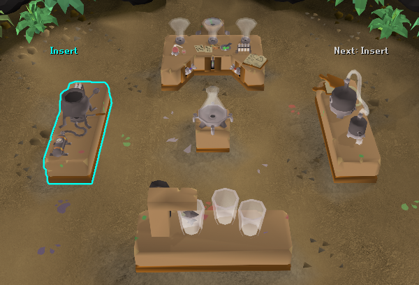

# Mixology Plus

A step-by-step guide for the Mastering Mixology minigame in Varlamore. It picks which orders are worth making, shows you which lever to pull and in what order, and walks you through every station, digweed and deposit, one step at a time.

## Features

### Picks your orders
Choose a **Mode**:
- **Fastest points**: the orders that get you to your target reward quickest, weighing the +20% / +40% bonus for depositing orders together against the extra potions.
- **Most points per paste**: the orders that get the most reward out of your pastes, ignoring time. More selective; skips weak potions.
- **Maximum XP**: the orders that give the most Herblore XP for your time, including station bonus XP.

Choose your **Target reward** from any item in the Mixology rewards shop. The points modes only value the resins you still need for it.

### Guides every step
Only the current step is highlighted in the lab, in order:
- **Levers**: each lever is labelled with its place in the recipe (`1st`, `2nd, 3rd`), or a countdown (`3x`, `2x`, `1x`) for single-ingredient potions. The lever to pull next pulses. Leftover pastes in the mixer are taken into account.
- **Collect** the mix from the vessel.
- **Insert** at the right station, then stay on it until it's done: "Spam click!" on the Retort, "Click!" during the Agitator and Alembic speed-boost windows.
- **Deposit** at the conveyor segment nearest you.
- **Next step** preview: a faint "Next: ..." outline shows where you're heading after the current step.

### Digweed
When a digweed is ready to pick:
- it's outlined with "Collect" above it
- the game's hint arrow points at it (also on the minimap)
- a short yellow screen flash and a chat message tell you which potion to use it on

When you hold the digweed and that potion, combining them becomes its own step, with both items outlined in your inventory, so the double reward is never missed.

### Retort misclick guard
When the Retort isn't the station you need, its left-click becomes "Walk here", so spam-clicking after it finishes can't put your next potion in it. Right-click still works.

### Reward progress
A small box shows how far you are towards your target reward, e.g. `Reagent pouch 35%`, with a rough "Next in ~12m" estimate based on how fast your points have been coming in.

## Settings

| Setting | Default |
|---|---|
| Mode | Fastest points |
| Target reward | Aldarium |
| Label size % | 100 |
| Lever guidance, Station guidance, Quick-action flash | On |
| Retort misclick guard | On |
| Digweed highlight, waypoint arrow, chat message, screen flash, use highlight | On |
| Show reward progress | On |
| Show next step | On |
| Colours | Every highlight colour can be changed |

## What it doesn't do

- It never clicks, types or automates anything. It only draws highlights and suggestions; you make every input yourself.
- It only reads client-side game state (varbits, varps, your inventory and the lab's objects).
- Nothing is sent anywhere.

## Credits

Mixology Plus started as a fork of [Noot's Mixology](https://github.com/lrdigital/noots-mixology) by Liam Rourke (Nooters), used under the BSD 2-Clause licence (see `LICENSE`). The guidance, order picking, lever planning and most of the overlays have since been rewritten.
